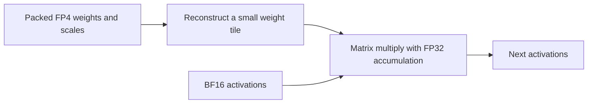

# Precision, memory and quality: notes from this project

This guide records the terminology behind the recipe. Our checkpoint is **nvidia/GLM-5.3-Flash-FP4-Local**, revision `76348ddb2be2e35e39ecfc00e75dc07703f4f3d5`. It contains a mixture of formats; “FP4 model” does not mean every tensor or operation uses four bits.

## Checkpoint, engine and cache

| Term | What it is in this project |
|---|---|
| Checkpoint | The NVIDIA model files and their exact revision |
| Inference engine | vLLM or TensorFold, which load those files and perform generation |
| Container image | The packaged engine, CUDA libraries, kernels and startup environment |
| Model cache | Files on disk under `/models_engrams/huggingface`, selected through `HF_CACHE_ROOT` |
| `HF_TOKEN` | An authentication credential, not a directory or a way to select model files; offline serving needs no token |

TensorFold is the inference-engine project used here. TensorFlow is a different machine-learning framework.

## W4A16: weights and activations are different

**W4A16 means 4-bit weights and 16-bit activations for the operations being described.** Weights are learned parameters stored in the checkpoint. Activations are intermediate values calculated as a prompt or generated token moves through the model.

A W4A16 implementation can keep weights compact in GPU memory, reconstruct small tiles for computation, multiply them by BF16 activations, and accumulate products in FP32. This does not require expanding the whole checkpoint to BF16. The implementation and temporary buffers determine actual memory use.

The A16 label alone does not distinguish BF16 from FP16; our described paths use BF16. Scales, higher-precision tensors, caches and scratch buffers also mean a “4-bit model” does not use exactly one quarter of an all-16-bit model's runtime memory.

This diagram illustrates a W4A16 path, not every operation in the model.

For our mixed checkpoint, W4A16 describes particular paths, not every layer. Some other projections are FP8, and some tensors retain higher precision. Our TensorFold build preserves the target checkpoint's stored values through its loaders; the PR's existing quantized speculative draft head is a separate component.

Using BF16 activations with FP4 weights is not a further downgrade of those weights. Reconstructing a quantized value in a wider format cannot recover information lost during the original quantization, but widening is not inherently another lossy quantization. Overall engine accuracy still depends on the implementation, rounding and other approximations.

## A small precision glossary

| Term | Meaning | Why it matters here |
|---|---|---|
| FP32 | 32-bit floating point | Often used to accumulate many products and for sensitive intermediate values |
| BF16 | 16-bit floating point with 8 exponent bits and 7 fraction bits | Broad numerical range; used for many activations in our native paths |
| FP16 | Another 16-bit format, with 5 exponent bits and 10 fraction bits | More fraction precision than BF16 near a given value, but a smaller range; the names are not interchangeable |
| FP8 | An 8-bit floating-point family; format and scaling matter | Used by some checkpoint tensors and by our KV-cache configuration |
| FP4 | A 4-bit floating-point family | Very few representable levels; scaling and quantization choices matter |
| Accumulation precision | The format used while summing products | FP4 weights do not imply a four-bit running sum |
| Mixed precision | Different tensors/operations use different formats | The accurate description of this NVIDIA checkpoint |

BF16 and FP16 are both 16-bit storage types with different range/precision tradeoffs. Reference: [NVIDIA's discussion of floating-point formats](https://developer.nvidia.com/blog/floating-point-8-an-introduction-to-efficient-lower-precision-ai-training/).

## NVFP4 and compressed scales

NVFP4 uses FP4 values with scaling information. NVIDIA describes a fine-grained E4M3 FP8 scale for each 16-value block, together with an FP32 scale at the tensor level. Those scales are part of the representation, not optional metadata. [NVIDIA NVFP4 description](https://developer.nvidia.com/blog/introducing-nvfp4-for-efficient-and-accurate-low-precision-inference/)

Our checkpoint additionally stores many scale tensors using **CSF32 (`csf_32x2_v1`)**, a lossless encoding. Distinguish two operations:

- **Quantization:** approximating higher-precision values with a lower-precision representation. This can lose information and affect model quality.
- **Lossless scale compression:** encoding the already-chosen scale values more compactly. Correct decoding reconstructs exactly those values.

TensorFold already had NVFP4 support, but its original GLM path did not connect all of this checkpoint's mixed formats and compressed scales to the loader. [PR #1050](https://github.com/ashhart/TensorFold/pull/1050) supplies that integration. This was a specific checkpoint-format gap, not proof that TensorFold cannot run NVFP4.

The pinned PR alone decodes the compressed scales for its GPU layout. Our header accounting found about 8.11 GiB more data in fully expanded scale planes across the model. That is representation accounting, not proof that a future GPU codec would recover exactly that much live VRAM. A lossless GPU representation could preserve values while trading decoding work against memory savings.

## KV-cache precision is separate from weight precision

The KV cache stores attention state from tokens already processed. Its size grows with context and active conversations. This hybrid model also has recurrent state and sparse-attention/index structures, so not all runtime state is conventional KV.

Our recipes use **FP8 KV cache**. That is independent of the FP4 weights: a model can have FP4 weights, BF16 activations, FP32 accumulations and FP8 cached attention state simultaneously. Quantizing the cache is another possible source of numerical differences, especially worth testing at long contexts. Passing one retrieval prompt does not prove all long-context tasks are unaffected.

The retained **prompt/prefix cache** is another distinction: it preserves work for reuse by future requests. Setting its budget to zero does not remove the live state needed for the request currently running, and does not move that live state to the CPU.

## Context capacity, actual use and headroom

A token is a tokenizer unit, not necessarily a word. A context window must accommodate the input plus generated tokens, including reasoning tokens when enabled.

“Configured for 1M” means the server accepts or plans for that limit. It does not prove a million-token prompt ran, or that the model used all of it accurately. We separately record startup, actual input/output token counts, retrieval/task scores and memory margins.

Our TensorFold ladder exercised 524,027 prompt tokens successfully, but left only 339 / 492 MiB free on the two cards. The 1M configuration failed before readiness. The tested 256K profile had materially more headroom. See [the validation record](VALIDATION.md) for exact settings and evidence.

A memory-utilization fraction or reserve setting is a budgeting policy, not additional physical memory. Docker `--shm-size` controls host shared memory; increasing it does not increase GPU VRAM. In the current native GLM implementation, the already-allocated first sequence can consume the requested reserve; measured free VRAM is therefore essential.

**GiB** means 2^30 bytes; **GB** usually means 10^9 bytes. Driver-reserved memory and reporting conventions also affect the capacity an application can actually allocate.

## Parallelism and speculative decoding

- **Tensor parallelism (TP):** distributes portions of model computation/weights across GPUs. TP2 does not automatically halve every cache or buffer; some structures remain replicated.
- **Decode context parallelism (DCP):** distributes attention-context work/storage across ranks when the engine implements it. vLLM's DCP setting is not a flag we can transplant into TensorFold.
- **MTP/speculative decoding:** proposes tokens ahead, then checks them with the target model. It aims to accelerate decoding while preserving the target's behavior under the algorithm's conditions. We test drafted/plain agreement; that bounded evidence is not a proof for every sampling mode.

### Does drafting require another downloaded model?

Our TensorFold GLM path uses the **MTP component bundled in the same checkpoint**.
Its loader builds the MTP layer/head, and the target model verifies the proposed
tokens. The PR's existing draft-head transformation remains unchanged in our
warp experiment. We have not downloaded or loaded an external draft model.
The response records `drafts`, proposed/accepted token counts and a token hash;
our tests explicitly compare `draft=true` with `draft=false`.

A separate small autoregressive model is another way to supply draft tokens.
**DFlash** instead uses a small diffusion drafter to propose a block in parallel,
conditioned on the target's hidden states. Deploying that approach needs
compatible draft weights and engine integration; an arbitrary small model is
not a replacement for a trained DFlash drafter. See the
[official DFlash algorithm documentation](https://github.com/vllm-project/speculators/blob/main/docs/user_guide/algorithms/dflash.md).

Our vLLM command explicitly selects `method: "mtp"` with three speculative
tokens. The accompanying `VLLM_GLM53_DFLASH_ATTN=1` environment variable does not
by itself establish that DFlash draft weights are loaded. Neither engine in our
measured comparison uses a separately downloaded DFlash model.

Acceptance rate, verification cost and prompt length determine whether drafting
helps. Measure it on/off at fixed precision and request settings; do not assume
that a larger draft model or more speculative tokens will be faster. External
drafter weights and state would also need their own memory budget.

Changing FP4 weights to a different quantization is a numerical change. Moving an unchanged embedding table to host memory is principally a placement/performance change, though the implementation still needs correctness tests. Replacing BF16 activations with FP4 activations is an additional quantization and requires accuracy qualification.

## Kernel tuning vocabulary

A **warp** is a group of 32 CUDA threads. A **thread block** (also called a CTA)
contains one or more warps. Our first TensorFold experiment changes the NVFP4
expert decode block from four warps (128 threads) to one warp (32 threads).
In this implementation, each warp owns independent matrix tiles. Changing that
grouping changes scheduling and residency, while the source keeps each tile's
arithmetic unchanged. That is an expectation to test, not a substitute for
numerical and output comparisons.

An **SM** is a GPU multiprocessor that executes thread blocks. **Occupancy**
describes how much work can reside on an SM given limits such as registers,
shared memory and threads. More occupancy does not always mean more speed:
memory traffic, instruction dependencies and launch overhead also matter.
TensorFold already detects our 188 SMs and uses kernel occupancy for this expert
path; the warp-grouping choice remains a separate tuning variable.

**Tiles** divide a matrix operation into smaller pieces. **Split-K** divides its
summation dimension among workers and then combines partial results. It can
expose more parallel work but adds reduction cost and can change rounding.
Prefill and decode have different shapes, so a choice that helps one can hurt
the other.

A **bracketed A/B/A experiment** runs the baseline, candidate, then baseline
again with identical requests. The second baseline helps reveal temperature,
clock or other time-dependent drift. It does not eliminate every confounder.
Warmup calls are excluded, repeated measurements are retained, and output hashes
are checked separately from timing. In our bounded throughput test, hitting the
256-token cap is intentional; in the quality suite, truncation is a diagnostic
that must be reported.

## Startup speed is not inference speed

Safetensors and InstantTensor are loading approaches. A faster loader can shorten startup without improving tokens per second after the model is resident. In our vLLM experiments, the InstantTensor path failed its available-memory check while safetensors loaded successfully. This did not establish that InstantTensor is universally slower or inferior.

Similarly, higher advertised FP4 throughput does not guarantee faster W4A16 inference. Memory bandwidth, matrix shapes, occupancy, communication and the actual arithmetic path all matter. Our SM120 adaptation/tuning record is [SM120-NOTES.md](../tensorfold/SM120-NOTES.md).

## What each kind of test tells us

| Test | Evidence it provides | What it does not establish |
|---|---|---|
| API smoke checks | Requests, JSON, tools and streaming work | General answer quality |
| Loader checks | Selected uploaded tensors match checkpoint-derived values | Every full-model computation is correct |
| Numerical kernel tests | Operations satisfy specified reference/error bounds | A model's task accuracy score |
| Draft/plain or cache/cold comparisons | These execution modes agree on tested cases | Universal agreement for all inputs and sampling modes |
| Needle/retrieval tests | The tested information can be recovered at a measured length | Broad reasoning or instruction following across that window |
| GSM8K | Math word-problem answer accuracy under a stated protocol | Coding, general knowledge or long-context accuracy |
| IFEval | Compliance with verifiable instructions | All aspects of helpfulness or semantic correctness |
| RULER | Multiple synthetic long-context capabilities | A complete measure of real-world document understanding |

Our [initial quality benchmark](../quality/README.md) uses pinned official lm-evaluation-harness task definitions and graders. It compares the same quantized checkpoint in two engines. It does **not** measure the quality lost when NVIDIA produced the quantized checkpoint from a higher-precision model; that would require an appropriate higher-precision reference and another controlled experiment.

## Reading scores without overclaiming

A score on 128 questions is an estimate, not the exact accuracy on all possible questions. We report a 95% Wilson interval for binary task accuracy. Sampling intervals do not account for benchmark contamination, grading limitations or mismatch with your real workload.

Because both engines receive the same selected questions, paired comparisons are more informative than comparing two unrelated percentages. The report shows which items differ and a paired bootstrap interval for the score difference. Small differences with an interval spanning zero are inconclusive in this sample; that does not prove the engines are equivalent.

Reasoning and final-answer text must be handled consistently. Our initial profile renders a shared prompt requesting low reasoning, allows 4,096 total output tokens, and grades only text after `</think>`, stripping surrounding whitespace. A missing closing marker is flagged and scored as an empty answer; truncations are reported rather than silently discarded. HTTP or tokenization errors abort a valid benchmark run instead of being presented as a quality score.

## Prefill, decode and first-token time

**Prefill throughput** measures processing of the input prompt. **Decode
throughput** measures generation after the first output token. **TTFT** is the
time until the client receives its first token/text; it also includes HTTP,
queueing and other overhead. Server-specific prefill timers need not begin and
end at identical boundaries. Report TTFT alongside them when comparing engines.
For a short prompt, dividing a few tokens by fixed startup overhead can produce
a low prefill rate that says little about long-prompt performance.

Our shared speed test explicitly closes the thinking prefix and times the first
nonempty raw text. This differs from timing the first visible answer after a
variable reasoning phase. The [performance report](PERFORMANCE-BASELINE.md)
keeps those definitions explicit. Its 256-token output cap is for throughput;
it is not the output allowance used in the accuracy suite.

**Teacher forcing** evaluates predictions at a fixed token history supplied by
the test, rather than allowing each candidate to generate a different history.
A small numerical change can select a different token when two logits are close;
after that, freely generated text may diverge substantially even if later
arithmetic is unchanged. Fixed-history comparisons therefore report target-token
log probabilities, top-one changes and the original top-two margin. They help
locate numerical effects, but agreement on sampled histories does not prove
identical behavior for all prompts or replace task accuracy measurements.

## What the measured engine speed gap tells us

Both recipes run locally on the same two GPUs. At 8K input / 256 output, the
current vLLM/B12X recipe is about 42% faster in MTP-enabled decode and 2.27 times
as fast in reported prefill throughput. With MTP disabled its decode is still
about 69% faster. Speculation alone therefore does not explain the gap.

Concrete implementation differences include vLLM's selected B12X attention,
expert and linear backends, CUDA-graph configuration, specialized PCIe all-reduce
and KDA prefill settings. TensorFold uses its own kernels and communication
schedule. Its diagnostic profile identifies routed experts as the largest
measured stage, followed by KDA and MLA. These identify plausible optimization
areas; matched cross-engine GPU traces and controlled ablations have not been
run, so we cannot assign a measured percentage of the gap to each mechanism.
The same checkpoint does not imply identical runtime representations or arithmetic.
See [the measured comparison](PERFORMANCE-CURRENT.md) and
[the profiling notes](../tensorfold/SM120-NOTES.md).

## NCCL device-cuMem and host-cuMem

NCCL is NVIDIA's GPU communication library. Our `cumem-device` experiment sets
`NCCL_CUMEM_ENABLE=1`, selecting CUDA `cuMem*` allocation functions for NCCL.
The separate `NCCL_CUMEM_HOST_ENABLE` flag selects cuMem allocation for NCCL's
host-memory side. These control allocation mechanisms for communication; they
do not increase physical VRAM, compress model weights or automatically move
embeddings/KV to CPU memory. [NVIDIA's definitions](https://docs.nvidia.com/deeplearning/nccl/user-guide/docs/env.html#nccl-cumem-enable).

Both flags were tested separately on this host without a clear performance
benefit, so the native recipe retains its explicit zero values. The mapped BF16
embedding experiment is separate code that places the immutable embedding table
in pinned host memory; enabling NCCL's host-cuMem flag does not implement that.

## Which engine has the 1M memory shortfall?

The approximately 2.15 GiB shortfall was the projected TensorFold gap after mapped
embedding, before resident compressed scales. Moving from 512K to 1M requires
3.66 GiB more per rank; merely reaching zero free memory would not preserve the
1.5 GiB target. The new [resident-CSF32 implementation](../tensorfold/csf-resident/RESULTS.md)
measured a 3.80 GiB/rank physical headroom gain at 512K and passed near-1M inference
with 1,693/1,846 MiB sampled free. The limiting card has only 157 MiB above that target.
This is an implemented, separately pinned experiment with a measured capacity result.

The native reserve setting alone does not guarantee physical free memory: the first
sequence is allocated before admission. The capacity harness therefore checks actual
one-second telemetry after smoke and each rung, including startup peaks, and stops
if either card falls below 1,536 MiB. Those samples cannot capture every shorter peak.

vLLM already starts with a configured 1,048,576-token limit and reports roughly
1.84 million tokens of shared KV capacity. A near-1M vLLM request has not been
validated in this project. Configured capacity, successful near-window inference
and broad long-context accuracy are three separate claims.

## Pinned vLLM prefill is not necessarily W4A16 throughout

Inspection of release-10152026 (image digest
`sha256:745feb916ee816f5409fd58386114be4f22fbede7f9c0e0a7b8c4fe8dac0fb29`)
on 2026-10-24 found that `B12X_W4A16_A4_PREFILL=1` enables a hybrid policy:
supported prompt spans can use NVFP4 activation prefill, while decode uses A16.
`VLLM_B12X_MOE_FP4_FORCE_A16=1` selects the W4A16 family but does not disable that
prefill policy. Dispatch additionally requires prepared calibration scales and
scheduler metadata; source configuration alone does not prove every launch used A4.
The V2 runner constructs that metadata, and the B12X MoE dispatcher partitions spans.

Thus our same-checkpoint cross-engine benchmarks do not establish identical
activation precision. TensorFold's current expert kernels use BF16 activations.
Hybrid A4 prefill is a plausible contributor to vLLM's speed advantage, not a measured
explanation of the entire gap. Native TensorFold also chunks prefill at 2,048 tokens,
versus the supplied vLLM batch budget of 4,096. These are separate profiling/ablation
questions. Implementing A4 would change arithmetic and require new quality gates;
it is outside the lossless compressed-scale residency patch.

Evidence: [pinned source audit](../tensorfold/results/vllm-prefill-policy-audit-v1.json),
CPU-only source inspection in `logs/csf-resident-v1/vllm-prefill-dispatch.log`
and `vllm-precision-paths.log`; `vllm/utils/b12x.py`,
`vllm/model_executor/layers/fused_moe/b12x.py`, the CSF quantization adapter and
`flashinfer`'s `w4a16/prefill_a4.py`. No vLLM configuration was changed for this audit.
