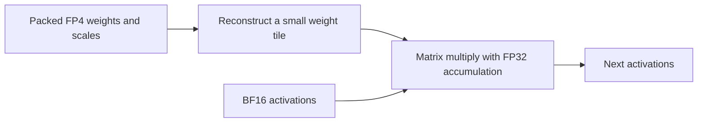

# Precision, memory and quality

Checkpoint: **nvidia/GLM-5.3-Flash-FP4-Local**, revision
`76348ddb2be2e35e39ecfc00e75dc07703f4f3d5`. This is a mixed-format checkpoint:
FP4 routed experts, FP8 projections and higher-precision tensors.

## Recipe terms

| Term | Meaning here |
|---|---|
| Checkpoint | NVIDIA model files at the pinned revision |
| Engine | vLLM or TensorFold |
| Container image | Engine, CUDA libraries, kernels and startup environment |
| Model cache | `/models_engrams/huggingface`, selected by `HF_CACHE_ROOT` |
| `HF_TOKEN` | Authentication credential; offline serving needs none |

## W4A16 and floating-point formats

**W4A16 means 4-bit weights and 16-bit activations.** Weights are stored learned
parameters; activations are intermediate values computed during inference. Our
TensorFold expert path reconstructs small weight tiles, multiplies them by BF16
activations and accumulates in FP32. The full model stays compact in GPU memory.
Scales, higher-precision tensors, live state and scratch add to its footprint.

| Format | Properties | Use here |
|---|---|---|
| FP32 | 32-bit floating point | Accumulation, norms and sensitive intermediate values |
| BF16 | 8 exponent bits, 7 fraction bits | Native activations; broad numerical range |
| FP16 | 5 exponent bits, 10 fraction bits | More fraction precision near a value, smaller range than BF16 |
| FP8 | 8-bit family; scaling/format matter | Some checkpoint tensors and KV cache |
| FP4 | 4-bit family with few representable levels | Compact weights with scales |

A16 can mean BF16 or FP16; these native paths use BF16. Widening a quantized value
for computation preserves only the information retained by its original
quantization. Replacing BF16 activations with FP4 would add another quantization
step. [NVIDIA floating-point formats](https://developer.nvidia.com/blog/floating-point-8-an-introduction-to-efficient-lower-precision-ai-training/).

## NVFP4 and CSF32 scales

NVFP4 combines FP4 values with an E4M3 FP8 scale per 16-value block and an FP32
tensor-level scale. [NVIDIA NVFP4 description](https://developer.nvidia.com/blog/introducing-nvfp4-for-efficient-and-accurate-low-precision-inference/).

This checkpoint stores many scale tensors with lossless **CSF32
(`csf_32x2_v1`)** encoding. Quantization approximates values; CSF32 compresses the
chosen scale bytes and reconstructs them exactly.

[PR #1050](https://github.com/ashhart/TensorFold/pull/1050) connects the checkpoint's
mixed formats and compressed scales to TensorFold's GLM loader. Its baseline
expands scales for the GPU layout. Header accounting found 8.11 GiB more bytes in
the expanded scale planes across the model. Our later resident-scale extension
saves about 3.80 GiB/rank physically after TP slicing, scratch and metadata; its
measured decode/prefill cost is recorded in
[resident-scale results](../tensorfold/csf-resident/RESULTS.md).

## Cache, context and headroom

**FP8 KV** stores attention state independently of the FP4 weight format. This
hybrid model also has recurrent state and sparse-attention/index structures.
Live state grows with context and active requests. Retained prompt/prefix caches
save work for later requests; setting their budget to zero leaves current-request
state in place.

A context window includes input, generated output and any reasoning tokens.
Record actual token counts, task scores and free memory alongside the configured
ceiling. **GiB = 2^30 bytes; GB = 10^9 bytes.** Docker `--shm-size` controls host
shared memory, while GPU fractions/reserves control allocation budgets.

The original TensorFold image passed a 524,027-token prompt with only 339/492 MiB
free and failed 1M allocation before readiness. Mapped embeddings saved
1,208 MiB/card but left a projected 2.15 GiB shortfall. The later resident-CSF32
image passed near-1M inference with **1,693/1,846 MiB free**. GPU 0 has just
157 MiB above the 1,536 MiB test floor. Moving 512K→1M adds about 3.66 GiB/rank of
identified state. [Validation history](VALIDATION.md).

GLM allocates its first sequence before reserve admission, so the capacity harness
samples free VRAM every second and stops below 1,536 MiB. On 2026-10-24, vLLM was
configured for 1,048,576 tokens and reported about 1.84 million shared KV tokens;
its near-1M inference test was still pending.

## Parallelism and drafting

| Mechanism | Behavior in this recipe |
|---|---|
| TP2 | Splits model computation/weights across two GPUs; some state remains replicated |
| DCP2 | vLLM's attention-context parallelism; TensorFold has its own state layout |
| MTP | The checkpoint's bundled draft component proposes tokens; the target verifies them |
| External drafter | Requires compatible weights, integration and a separate memory budget |

vLLM selects `method: "mtp"` with three speculative tokens. TensorFold records
`drafts`, proposed/accepted counts and token hashes; tests compare `draft=true`
and `draft=false`. Both use the bundled MTP component, with the PR's existing
draft-head transformation retained.

DFlash uses a diffusion drafter conditioned on target hidden states. It requires
trained, compatible draft weights; neither measured recipe loads them.
`VLLM_GLM53_DFLASH_ATTN=1` is an attention setting in our MTP launch.
[Official DFlash algorithm](https://github.com/vllm-project/speculators/blob/main/docs/user_guide/algorithms/dflash.md).

Draft acceptance, verification cost and prompt length determine the speedup.
Compare MTP on/off with fixed prompts and generation settings.

## Kernel tuning and measurement

| Term | Meaning and local decision |
|---|---|
| Warp / CTA | A warp has 32 CUDA threads; a block has one or more warps. Our expert decode control selects one rather than four warps, preserving each tile's arithmetic. |
| SM / occupancy | SMs execute blocks; registers, shared memory and threads limit residency. TensorFold detects all 188 SMs/card. Memory traffic and dependencies also affect speed. |
| Tile / split-K | Tiles divide matrix work; split-K divides the summation and adds a reduction, which can alter rounding. Prefill and decode have different shapes. |
| A/B/A | Baseline→candidate→baseline timing with identical prompts detects drift. Exclude warmups and retain repeats/output hashes. |
| Teacher forcing | Fix the token history and compare target log probabilities, top-one choices and original top-two margins. |

Safetensors/InstantTensor affect loading. InstantTensor failed its MTP memory
check on this host; safetensors loaded successfully. Steady-state throughput is
measured after loading. [SM120 adaptation record](../tensorfold/SM120-NOTES.md).

**Prefill** processes prompt tokens. **Decode** generates after the first output
token. **Client TTFT** includes HTTP, queueing and time to the first nonempty raw
text frame. Our speed prompts explicitly close the thinking prefix and request
256 output tokens. Short-prompt prefill rates include substantial fixed overhead;
server prefill timer boundaries vary by engine.
[Performance protocol](PERFORMANCE-BASELINE.md).

## Quality tests and scores

| Test | Recorded evidence |
|---|---|
| API smoke | Text, JSON, tool parsing and streaming |
| Loader/kernel gates | Uploaded tensor equality and numerical reference/error bounds |
| Draft/plain, cache/cold | Output hashes across execution modes |
| Retrieval | Recovery of hidden values at measured prompt lengths |
| GSM8K | Math-answer exact match |
| IFEval | Verifiable instruction compliance |
| RULER-derived screen | Retrieval, tracking, aggregation and QA by actual length |

The [quality protocol](../quality/README.md) compares the same quantized checkpoint
in both engines using pinned official graders, low reasoning, greedy generation
and a 4,096-token output allowance. It grades text after `</think>`; missing
closures score as empty answers, truncations remain visible, and HTTP/tokenization
errors abort the run. Scores include 95% Wilson intervals and paired bootstrap
comparisons on the same selected questions. Measuring quantization loss requires
a higher-precision reference model.

The resident-scale/GPU-embedding candidate matched all **256 earlier native
answers and 1,439 fixed-history probabilities**. Short scores were similar to
vLLM, with paired McNemar p=1.0. The near-1M screen returned **21/22 full-credit
answers and one partial frequency-aggregation answer**; matched long-context
engine comparisons remain pending.
[Short comparison](QUALITY-BAKEOFF-V2.md) · [Long results](LONG-CONTEXT-ACCURACY-V2.md).

## Cross-engine performance and arithmetic

At 8K input/256 output, archived vLLM was about 42% faster in MTP-on decode,
2.27× as fast in reported prefill, and 69% faster in MTP-off decode than the normal
TensorFold image. vLLM uses B12X attention/MoE/linear kernels, specialized PCIe
all-reduce and its own CUDA graphs; TensorFold has separate kernels and scheduling.
Native traces identify expert, projection and attention costs. Matched
cross-engine traces/ablations remain pending.
[Measured comparison](PERFORMANCE-CURRENT.md) · [Profiling notes](../tensorfold/SM120-NOTES.md).

The 2026-10-24 source audit of vLLM release-10152026, digest
`sha256:745feb916ee816f5409fd58386114be4f22fbede7f9c0e0a7b8c4fe8dac0fb29`, found
`B12X_W4A16_A4_PREFILL=1` enables hybrid NVFP4-activation prefill when calibration
and scheduler metadata permit. `VLLM_B12X_MOE_FP4_FORCE_A16=1` selects the family
while retaining this policy; decode uses A16. TensorFold experts use BF16
activations. Native prefill chunks are 2,048 tokens; vLLM's batched-token budget is
4,096. A4 and scheduling are candidates for controlled ablation. Adding A4 to
TensorFold requires new arithmetic/quality gates, separate from scale storage.

[Pinned source audit](../tensorfold/results/vllm-prefill-policy-audit-v1.json):
`vllm/utils/b12x.py`, `vllm/model_executor/layers/fused_moe/b12x.py`, the CSF adapter
and flashinfer `w4a16/prefill_a4.py`. Raw CPU-only inspection:
`logs/csf-resident-v1/vllm-prefill-dispatch.log` and `vllm-precision-paths.log`.

## NCCL cuMem flags

`NCCL_CUMEM_ENABLE` selects CUDA `cuMem*` allocation for NCCL's device side;
`NCCL_CUMEM_HOST_ENABLE` selects its host allocator. Both experiments showed no
clear gain, so the recipe retains zero values. Embedding placement is implemented
separately with an immutable BF16 table in pinned host memory.
[NVIDIA definitions](https://docs.nvidia.com/deeplearning/nccl/user-guide/docs/env.html#nccl-cumem-enable).
